<p align="center">
  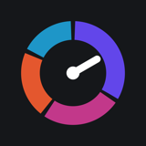
</p>

<h1 align="center">Hourfolio</h1>

<p align="center">
  <b>Your time, invested.</b><br>
  A time portfolio for people with many hobbies. Every hobby is an asset, hours are the currency, and rest counts as an investment too.<br>
  <sub>iOS and Android · English, Українська, Polski · local-first, no account</sub>
</p>

<p align="center">
  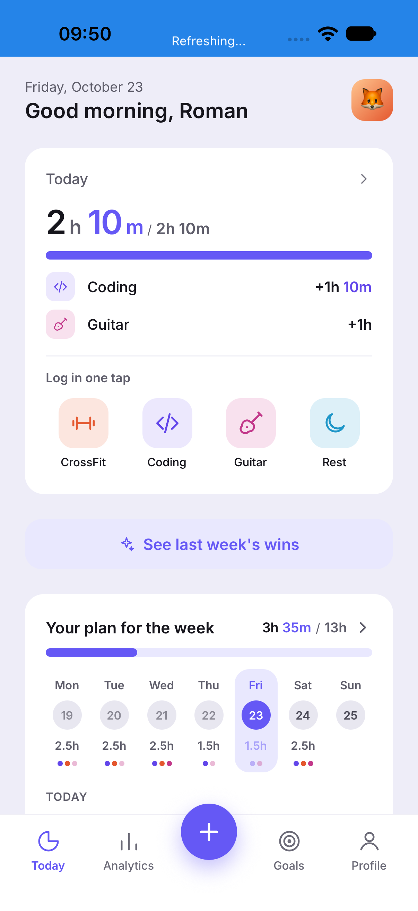
  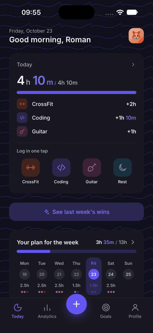
  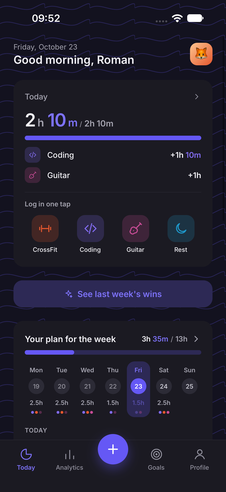
</p>

## Why

Most habit apps reward one thing done every day and punish breaks with broken streaks. People with a guitar, a gym routine, a side project and a stack of books to read end up feeling behind on all of them.

Hourfolio does the opposite. It shows how your time is spread across everything you care about, and it never makes you feel guilty about it:

- No streaks, and no red numbers.
- A hobby on a break is **resting**, not failing.
- Rest is an asset in every portfolio.
- Reminders only ever say "you're nearly there" or "rest counts too". They never say "you missed".

## How it works

| | |
|---|---|
| **Capital** | Every hour you have put into a hobby. It never goes down. |
| **Momentum** | Recent activity on a 0–100 scale. It fades during a break but never drops below 20, and it decays at each hobby's own rhythm (daily, a few times a week, weekly, whenever). |
| **Recovery** | In every portfolio. Rest days show up as their own thing, not as gaps. |
| **Energy balance** | Your time split into body, creative, mind and recovery. |
| **Weekly goals** | Optional. Each goal shows the week as a pace bar: seven day segments and a thin marker for an even pace today. Missing one changes nothing. |
| **Weekly plan** | Optional. The week is proposed from your goals straight away, so you know what to do when. Drag a session to another day. |
| **Achievements** | Every finished week, and badges such as "Rest counts" or "100 hours invested". A badge, once earned, stays. |

## A tour

### Today and this week
The first screen shows today and this week, not a chart. The Today card has what you did today against today's plan, hobby by hobby; tap it to see every entry, make one longer or shorter, or delete it. Below are one-tap tiles for what you usually do, your plan for the week (a progress bar, hours for each day and today's sessions as tiles in each hobby's color), and every hobby with its capital. A button opens last week's recap. Weekly goals live on the Goals tab as pace bars. On an empty morning it asks "What are you investing in today?" instead of showing a zero.

<p align="center">
  
  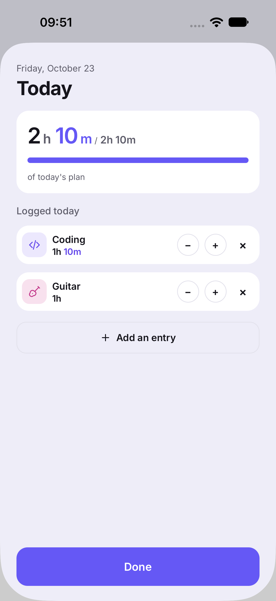
  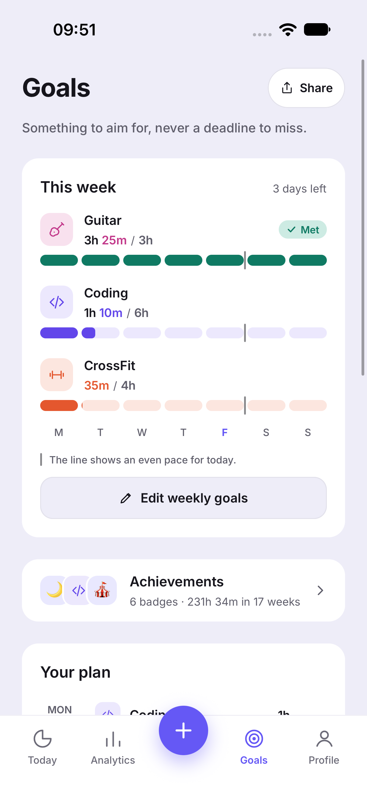
  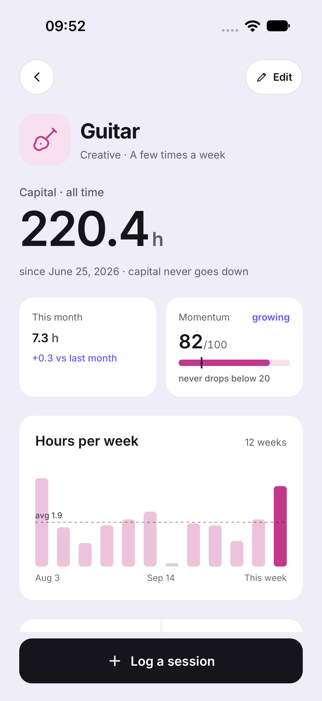
</p>

### Plan your week
Open the planner and the week is already laid out: your weekly goals spread over the days ahead, weekends lighter, something planned each day. Say you want 6 hours of coding, 4 of CrossFit and 3 of guitar: coding goes on most days and the rest is mixed in around it. There is nothing to fill in first.

- **Sessions fit the activity:** reading splits into short 20–30 minute bites, a workout gets a longer block, and a big goal stretches the sessions rather than losing time.
- **Rhythm:** the same hobby isn't put on back-to-back days when it can be avoided. Each hobby can be limited to some weekdays (CrossFit not on weekends) in its editor.
- **Drag and drop:** drag a session by its grip to another day. The same hobby on one day adds up (30 m + 30 m = 1 h). Each session can be resized or removed, and each day has a + to put a hobby back on it.
- **Free time is optional:** "Adjust free time" opens the hours each day has and how much rest to plan. Leave it closed and the plan decides.
- **No guilt:** time that doesn't fit is just said plainly, on the plan and on Goals, and a missed session quietly moves on when you re-plan the rest of the week.
- **Where it shows:** Today has the week as a strip with each day's hours, and today's sessions as tiles with a "Log" chip. Goals has the whole plan, with "Edit plan" and "Plan next week" buttons. Without a plan, Today offers to make one. From Friday it offers next week.
- **Goals and plan stay in step:** after you change weekly goals, the app offers to re-plan the rest of the week. A session counts as done once its time is logged that day.
- **Reminder (optional):** one note in the late afternoon about what is planned and not done yet, for today and tomorrow.

<p align="center">
  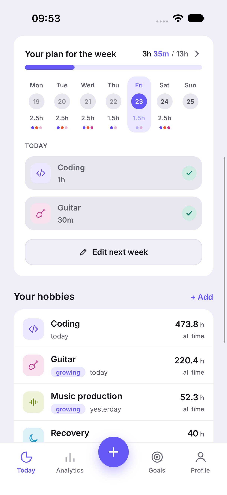
  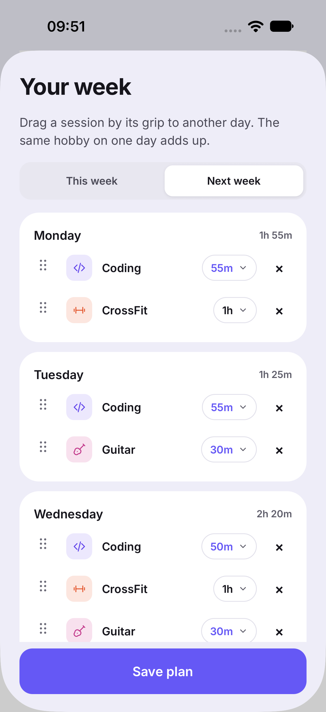
  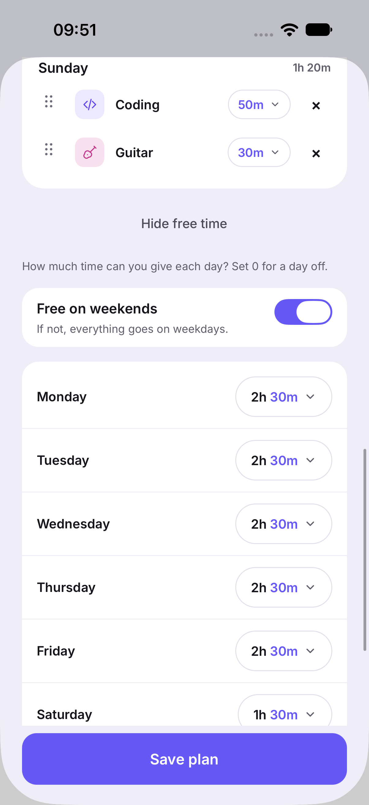
  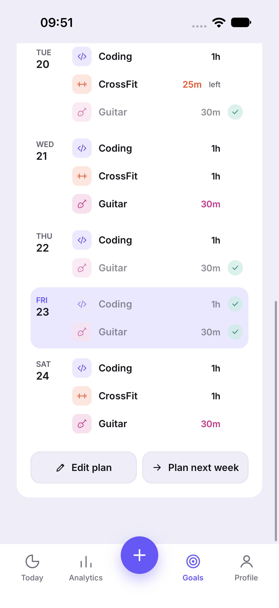
</p>

### Analytics
The charts live one tab over:
- hours for the week, month, year or all time, against the previous period;
- time allocation;
- per-asset trends;
- energy balance and a monthly calendar where recovery days have their own color.

<p align="center">
  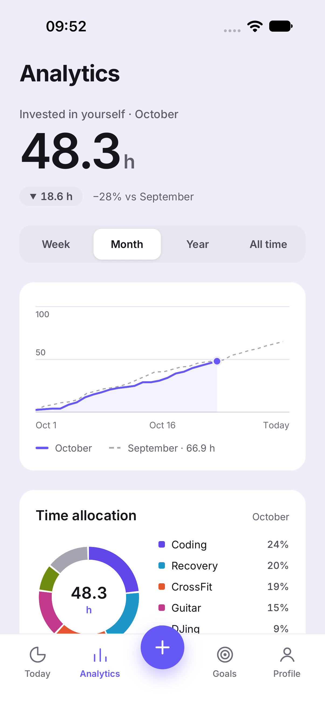
</p>

### Goals you want to share
Finishing a weekly goal opens a congrats screen with confetti and a share card, rendered as a PNG for Telegram, Threads, Instagram or anywhere else. There's also a "My week" card, from Goals or from any week's recap.

<p align="center">
  
  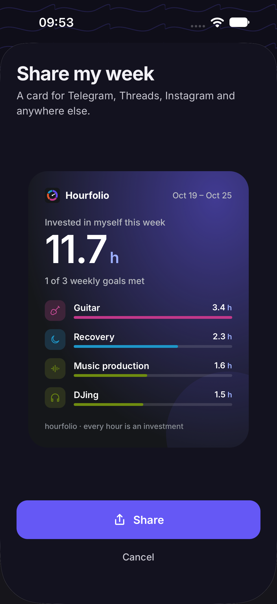
</p>

### Achievements
Weeks are the unit of progress. Goals has a slim Achievements card, and behind it every finished week with your time in it, grouped by month, and a shelf of badges: eight fixed ones (first hour, first full week, 10 and 20 hours in a week, rest on three days of a week, every hobby in one week, a plan done start to finish, 100 hours invested) plus hour marks for each hobby (50, 200, 500 and 1000 h). A week opens its recap: time invested, goals met, planned sessions done, the hobby with most time, rest days, the badges earned that week, and a Share button. A badge says how it was earned and links to its week.

Badges still ahead are named and explained, with no countdown or progress bar. A badge once earned stays, whatever happens to the logs later. A short week reads "2 of 3", in grey, never red.

<p align="center">
  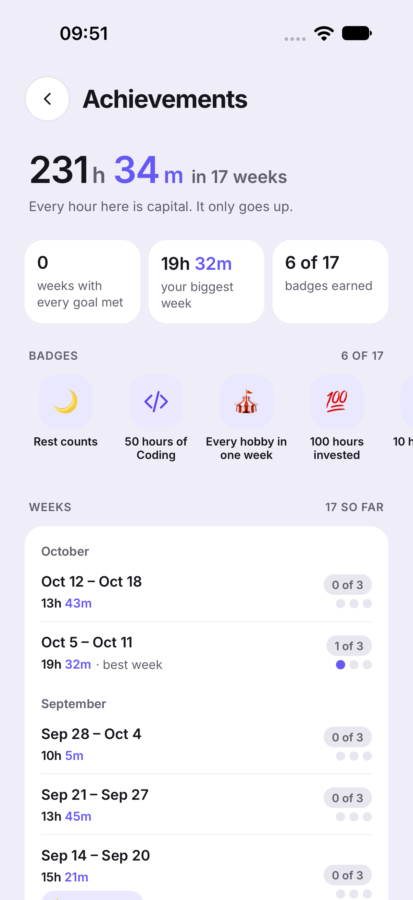
  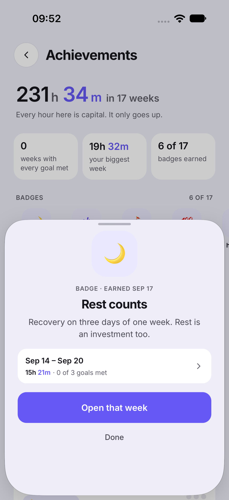
  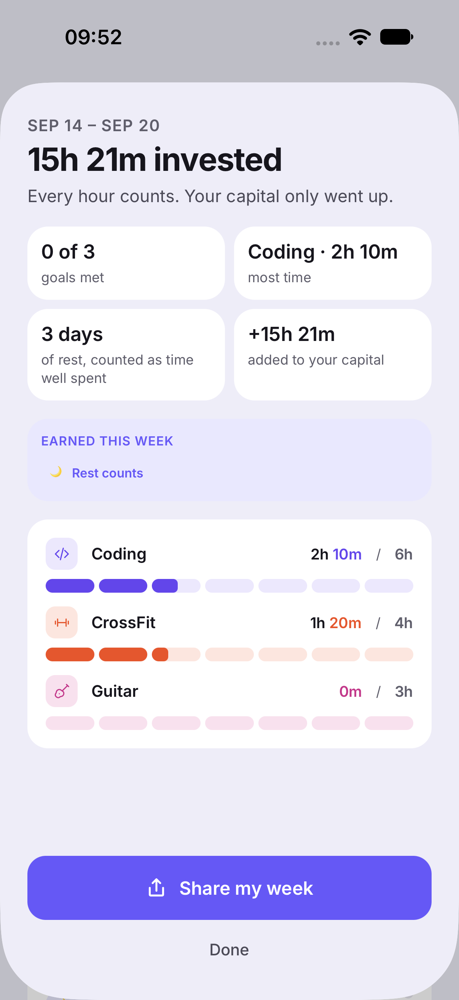
</p>

### Make it yours
- **Profile:** a preset character or your own photo as your picture.
- **Appearance:**
  - light, dark or system mode;
  - any accent color from the system color picker;
  - any page color, with text and cards adjusting to stay readable;
  - eight background patterns.
- **Hobbies:** each one can show an icon, an emoji (a full picker with search in all three languages) or a photo of your own guitar.
- **Units:** hours, minutes and days keep their colors whatever you pick.

<p align="center">
  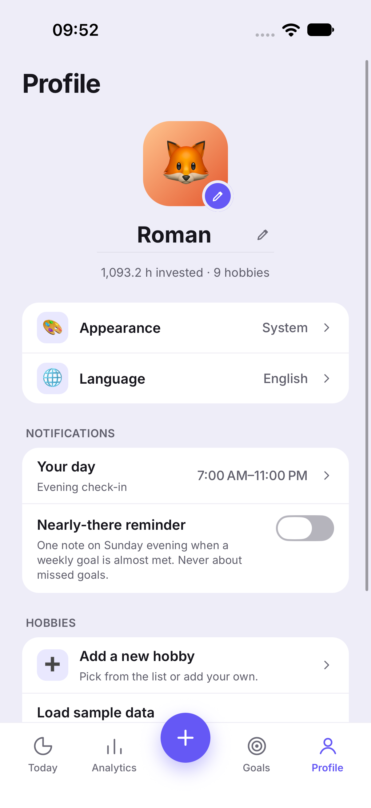
  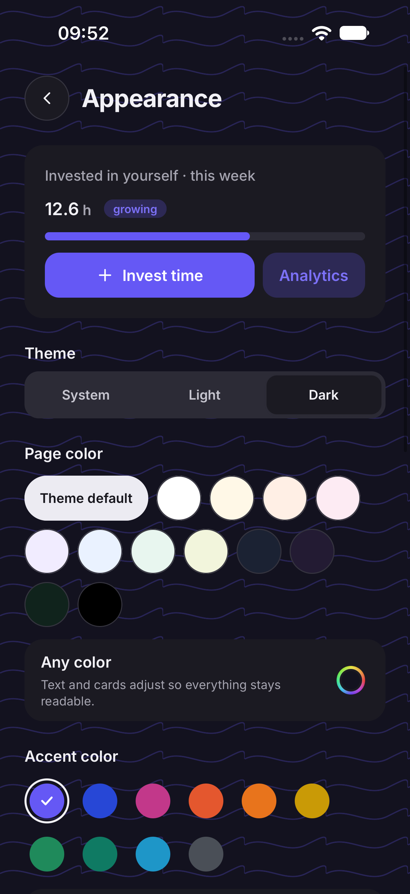
</p>

Holidays dress the app up. From mid-October the accent turns pumpkin, the scenes get holiday props, and you can switch to a holiday app icon, or have it switch by itself.

<p align="center">
  
  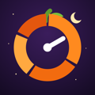
  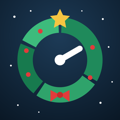
</p>

### Onboarding and gentle reminders
0. Three quick looks at the app after a few months of use: plan your week, see your progress, see your investment. Swipe through or skip.
1. Pick from 35 activities or add your own.
2. Tune each one: an optional weekly goal first (an hours-and-minutes picker), then a picture (an icon from the app, an emoji or your own photo), color, energy type and how often you do it. "Set up the rest later" skips to the next step. Every hobby starts at zero hours.
3. Tell the app when your day starts and ends.
4. Add a name, picture and color (optional).

There are three reminders, all off until you turn them on:
- **Evening check-in:** one note an hour before bed, only on days with nothing logged yet.
- **Nearly-there reminder:** one note on Sunday when a weekly goal is almost met.
- **Planned sessions:** one note in the late afternoon about what your plan has for today and tomorrow.

The app starts in your phone's language (English if it isn't one of the three) and there is no language question up front. Change it any time in Profile.

<p align="center">
  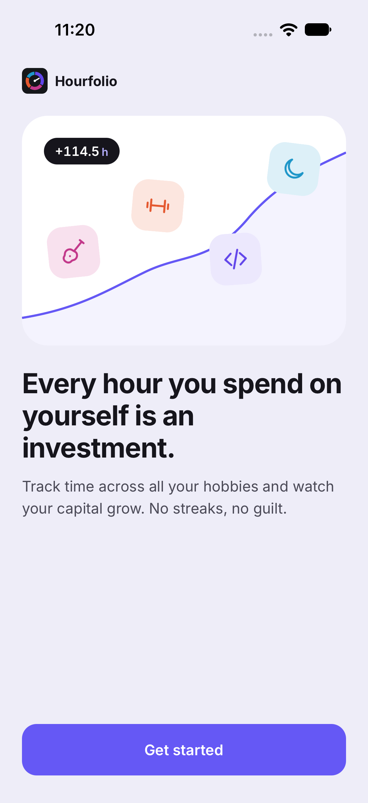
  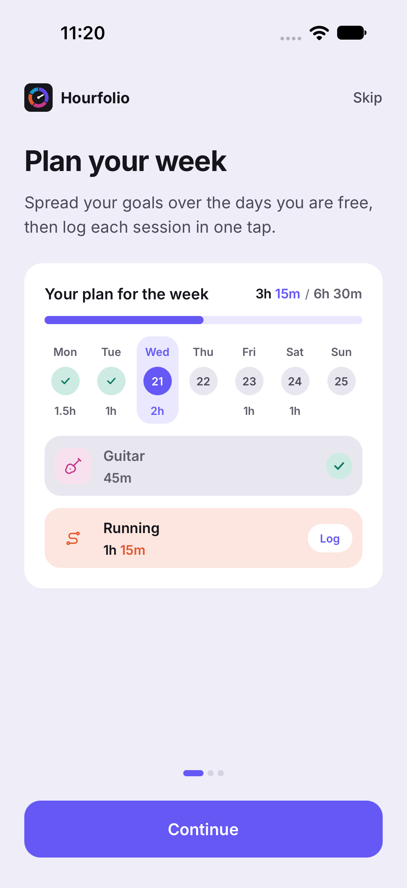
  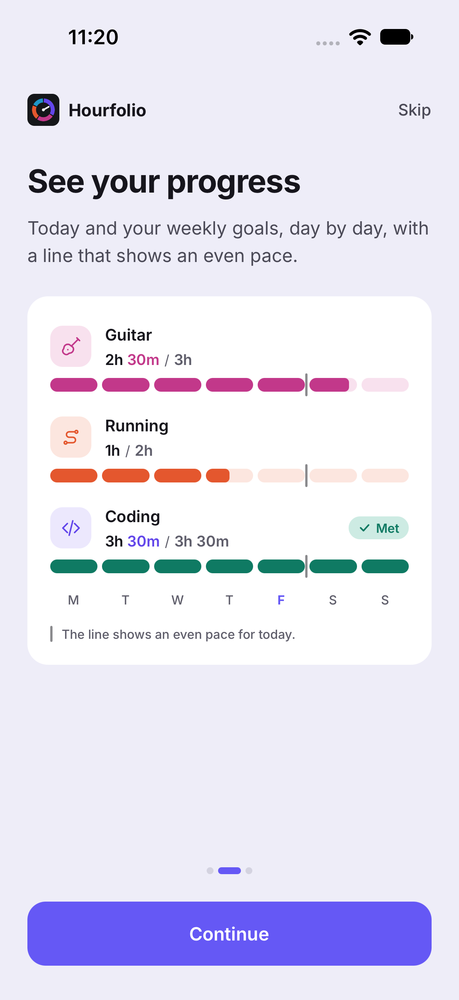
  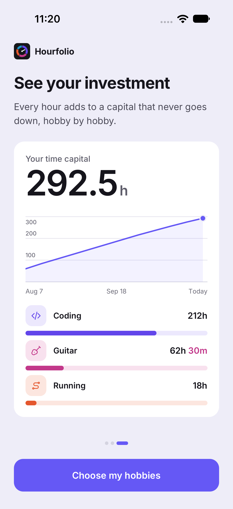
</p>

<p align="center">
  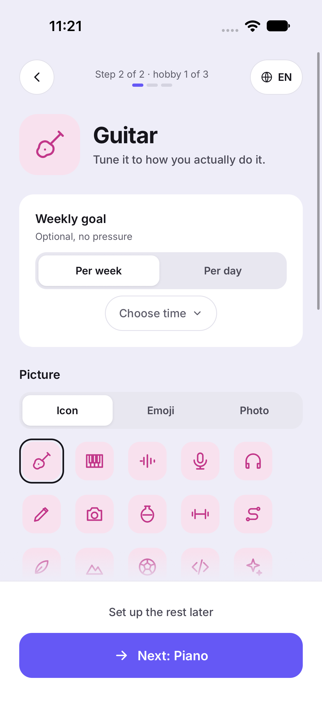
  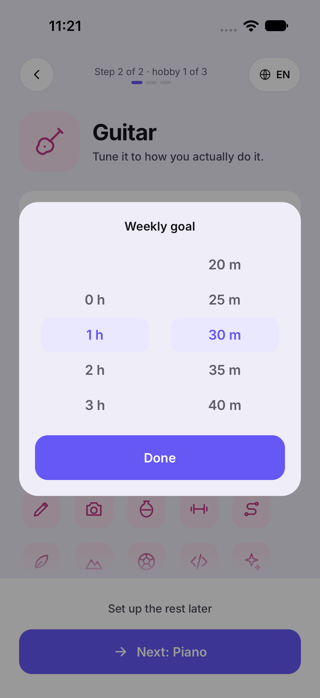
  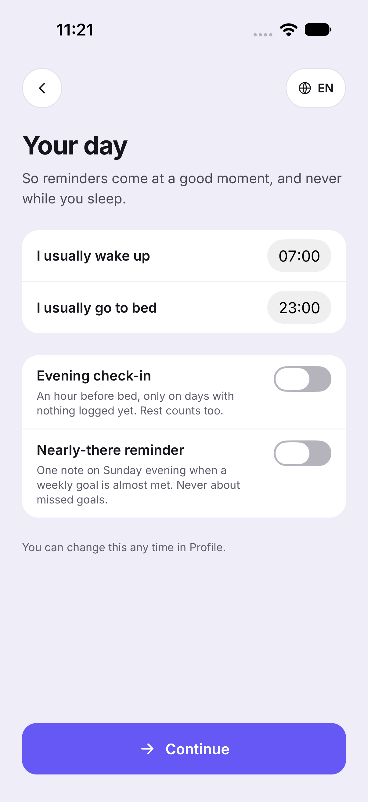
  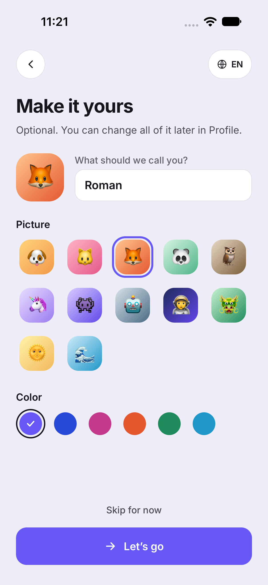
</p>

## Stack

Expo SDK 57 · React Native 0.86 · expo-router · TypeScript (strict) · Restyle (theme built at runtime) · zustand + MMKV · i18next · react-native-svg + Reanimated · @expo/ui (native color and time pickers) · expo-notifications (local only) · Jest · Maestro

```
src/
  domain/      pure logic, unit-tested: growth (capital, momentum), stats, goals and scenes,
               the weekly planner, the week recap and achievements, the day and reminders,
               seasons, colors and contrast, emoji search
  store/       zustand stores persisted to MMKV
  i18n/        EN / UK / PL, checked for missing keys and plural forms
  theme/       buildTheme({ mode, accent, page }); fixed colors for hours, minutes and days
  components/  UI building blocks, charts, goal scenes, share cards, confetti
  app/         expo-router screens
  data/        emoji data built from emojibase (scripts/build-emoji.mjs)
plugins/       config plugins: UIScene for the iOS 27 SDK, no push entitlement
e2e/           Maestro flows, which also take the screenshots in this README
```

## Run it

You need [mise](https://mise.jdx.dev) (it pins Node 22 and bun) and Xcode with an iOS simulator, or Android Studio with an emulator. MMKV needs native code, so this runs as a dev build, not in Expo Go.

```sh
mise install
mise exec -- bun install
mise exec -- bun run ios        # build and launch on the iOS simulator
mise exec -- bun run android    # the same on an Android emulator
mise exec -- bun run test       # unit tests
mise exec -- bun run typecheck
mise exec -- bun run lint
```

To try it with data, go to Profile → Load sample data (it includes a plan for the week).

End-to-end flows run with [Maestro](https://maestro.dev): `maestro test e2e/onboarding.yaml` (on an app that is already set up, run `e2e/start-over.yaml` first), then `e2e/tour.yaml` (it loads sample data and takes the screenshots). `scripts/readme-shots.sh <simulator udid>` runs both, copies the screenshots into `docs/screenshots/` and records the congrats GIF.

## Built with AI

This app is also a hands-on way to learn AI-assisted development with Claude Code. Each piece is in the repo:

| Piece | Where | What it does here |
|---|---|---|
| Project memory | [`CLAUDE.md`](CLAUDE.md) | Commands, layout and product rules such as "no guilt" and "tokens, never hex" |
| Skills | [`.claude/skills/`](.claude/skills) | `new-screen` (how a screen is built in this app), `on-device` (build and run on a real iPhone), `ota-update` (ship a JS-only update) and `create-pr` (checks and PR description) |
| Hooks | [`.claude/settings.json`](.claude/settings.json) | Lint and typecheck after every edit, so mistakes come back straight away |
| MCP | [`.mcp.json`](.mcp.json) | Maestro, so Claude can drive the simulator, check screens and take these screenshots |
| Subagents | in the session | Research on how other apps design their first screen, run in the background |
| Artifacts | claude.ai | Mockups of three home screen directions, to pick one before building |

The plan and the reasoning behind decisions are in [`docs/PLAN.md`](docs/PLAN.md).

## License

Copyright (c) 2026 Roman Blyztsiv. All rights reserved. See [`LICENSE`](LICENSE): the code may not be copied, modified or distributed without written permission.
